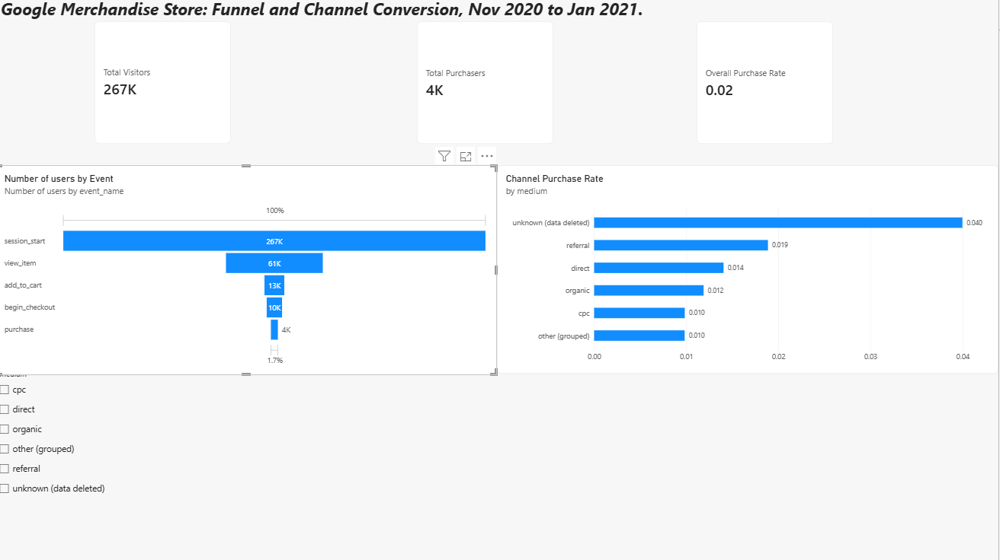

# GA4 E-commerce Funnel and Channel Analysis

Where does an online store lose shoppers, and which marketing channels turn visitors into buyers? This project answers both questions using three months of Google Analytics 4 (GA4) data from the Google Merchandise Store.

**Tools:** BigQuery (SQL) · Python (pandas) · Power BI



---

## Business questions

1. At which step of the purchase funnel does the store lose the most visitors?
2. Which traffic channels (mediums) convert visitors into buyers best, and at which steps do weaker channels fall behind?

## Data

| | |
|---|---|
| **Source** | Google's public GA4 sample dataset: `bigquery-public-data.ga4_obfuscated_sample_ecommerce` |
| **Store** | Google Merchandise Store (online shop selling Google-branded products) |
| **Date range** | 1 Nov 2020 to 31 Jan 2021 |
| **Size** | 267,116 users who started a session |
| **Unit of analysis** | Unique users (`user_pseudo_id`), not sessions |

The dataset is public and obfuscated by Google, so some values are replaced with placeholders (see Limitations).

## Method

1. **SQL (BigQuery):** counted unique users at each funnel step (`session_start`, `view_item`, `add_to_cart`, `begin_checkout`, `purchase`), overall and by traffic medium. See [`sql/`](sql/).
2. **Python (pandas):** calculated step conversion (each step compared with the step before), drop-off, and overall conversion (each step compared with all visitors). Then built per-medium funnels with the same rates and relabeled GA4's codes into readable channel names (for example, `(none)` became `direct`). See [`notebooks/`](notebooks/).
3. **Power BI:** built a dashboard with site-wide KPI cards, a funnel chart, and a purchase-rate-by-channel chart with a medium slicer. The site-wide figures use DAX measures on the funnel table (`CALCULATE`, `DIVIDE`), so they aren't affected by the channel overlap described below. See [`dashboard/`](dashboard/).

## Results

### Funnel (all users)

| Step | Users | Step conversion | Drop-off | Overall conversion |
|---|---|---|---|---|
| Session start | 267,116 | | | 100.0% |
| View item | 61,252 | 22.9% | 77.1% | 22.9% |
| Add to cart | 12,545 | 20.5% | 79.5% | 4.7% |
| Begin checkout | 9,715 | 77.4% | 22.6% | 3.6% |
| Purchase | 4,419 | 45.5% | 54.5% | 1.7% |

### Conversion by channel

| Medium | Visitors | Purchase rate | View rate | Cart rate | Checkout rate | Checkout to purchase |
|---|---|---|---|---|---|---|
| Referral | 54,380 | 1.9% | 23.4% | 21.2% | 77.6% | 48.9% |
| Direct | 75,025 | 1.4% | 22.0% | 20.2% | 72.8% | 43.4% |
| Organic | 111,346 | 1.2% | 21.6% | 18.7% | 73.2% | 40.1% |
| Other (grouped) | 50,777 | 1.0% | 20.6% | 18.8% | 69.7% | 36.5% |
| CPC (paid search) | 15,450 | 1.0% | 20.4% | 17.8% | 69.5% | 39.0% |
| Unknown (data deleted) | 17,210 | 4.0% | 29.0% | 27.4% | 83.4% | 60.3% |

## Findings

**1. Funnel drop-off**

The two biggest drop-offs happen early in the funnel: from arriving on the site to viewing an item, and from viewing an item to adding it to the cart. 77% of people leave without viewing an item, and almost 80% of those who view one leave without adding it to their cart. Combined, these two steps lose about 95% of the initial users, far more than the checkout and purchase stages.

**2. Channel performance**

The referral channel provides the best opportunity amongst the identifiable channels. Referral outpaces the other three identifiable channels (direct, organic and cpc) in purchase rate, view rate, cart rate, checkout rate and checkout-to-purchase rate, converting 1.9% of visitors into buyers compared with 1.4% for direct, 1.2% for organic and 1.0% for cpc. It does this while having the second-lowest number of visitors of the four. These findings can help our marketing team decide where to invest: growing referral traffic is likely the most efficient way to increase purchases.

## Recommendations

1. **Help visitors reach a product faster.** 77% of visitors never view a product, so the landing and home pages are the biggest opportunity. Test featured products, clearer navigation and more prominent search. *Metric to watch:* view rate (view item ÷ session start).
2. **Make product pages convert to cart.** Most people who view a product don't add it to their cart. Test showing price and shipping costs earlier, adding reviews, and stronger product images. *Metric to watch:* cart rate (add to cart ÷ view item).
3. **Grow referral traffic and review paid search before spending more.** Referral converts best at every step but sends relatively few visitors. Expand partner and affiliate links. Paid search converts worst while being paid per click, so check ad targeting and landing pages first. *Metrics to watch:* purchase rate by channel and, with spend data, cost per purchase.

## Limitations

- **Event-reach funnel, not a strict sequence.** Each step counts users who triggered that event at any point in the period, not users who completed the steps in order.
- **Channel totals overlap.** About 21% of users appear under more than one medium in this sample, so channel visitors add up to 324,188 against 267,116 site-wide (and purchasers to 4,742 against 4,419). Channels are compared as rates, and site-wide figures come from the funnel table only.
- **Obfuscated values.** Google replaced some traffic sources with placeholders (`<Other>`, `(data deleted)`). The "unknown (data deleted)" group shows the highest purchase rate, but it can't be acted on because the channel is unidentifiable.
- **Seasonality.** November to January covers the holiday shopping period, so conversion rates may run higher than in a typical quarter.
- **No cost or revenue data.** Without ad spend, paid search can be judged on conversion rate only, not return on spend.

## Repository structure

```
sql/
  01_funnel.sql          Unique users at each funnel step
  02_channels.sql        Funnel steps and purchase rate by medium
data/
  funnel.csv             Query 1 results
  channels.csv           Query 2 results
  funnel_clean.csv       Funnel with step, drop-off and overall rates
  channels_clean.csv     Channel funnel with step rates
notebooks/
  ga4_funnel_analysis.ipynb
dashboard/
  ga4_funnel.pbix        Power BI report
  dashboard.png          Dashboard screenshot
README.md
```

## How to reproduce

1. Open the [BigQuery sandbox](https://console.cloud.google.com/bigquery) (free, no credit card needed).
2. Run the two queries in `sql/` and export each result as CSV into `data/`.
3. Run the notebook in Google Colab or Jupyter to create the two `_clean.csv` files.
4. Open `dashboard/ga4_funnel.pbix` in Power BI Desktop and refresh the data source paths if prompted.

## Skills demonstrated

SQL on nested GA4 event data (conditional `COUNT(DISTINCT ...)`, `SAFE_DIVIDE`, wildcard tables) · funnel and conversion analysis in pandas · data validation (catching the channel overlap before reporting totals) · DAX measures in Power BI · turning analysis into business recommendations

---

**Author:** Amoni Haynes · [LinkedIn](https://www.linkedin.com/in/amoni-haynes-0b0bb6154)
